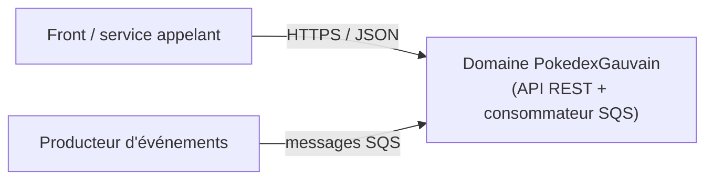
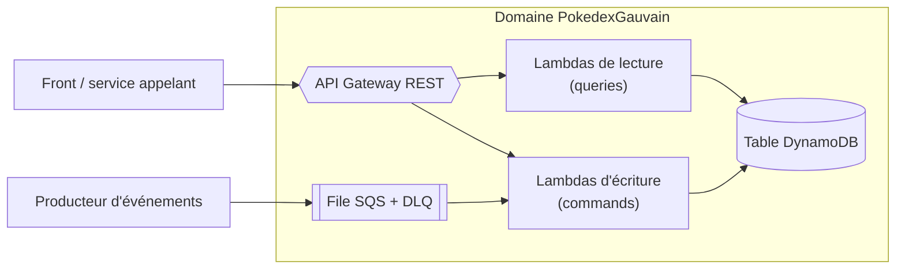

# Domaine `PokedexGauvain`

Scaffoldé depuis `@garance-retraite/create-domain`. Exemple fourni : un domaine Pokemon (aggregate, commande, query, adapters Lambda, repository DynamoDB).

## Architecture

> Claude Code : accepter la confiance du dossier au premier lancement interactif. Sans elle, `.claude/settings.json` (permissions et hook Stop `docs:check`) est ignoré.

Hexagonale + CQS : layout, principes et flux d'une requête dans [`ARCHITECTURE.md`](./ARCHITECTURE.md). Guide pour agents IA (commandes, pièges, recettes) : [`AGENTS.md`](./AGENTS.md).

Diagrammes Mermaid rendus par GitHub, maintenus par l'agent à chaque feature (skill `update-architecture-docs`, vérifié par `npm run docs:check`).

### Contexte (C4 niveau 1)



### Conteneurs (C4 niveau 2)



### Où mettre le code

```
src/
├── domain/                  # pur : aggregates (schéma zod + type), erreurs métier, ports + jetons d'injection
├── application/             # cas d'usage CQS : commands/<cas>/ et queries/<cas>/ (message + handler)
├── adapters/
│   ├── primary/serverless/  # une Lambda par endpoint ou consommateur (racine de composition)
│   └── secondary/           # implémentations des ports (DynamoDB…)
└── infrastructure/ioc/      # modules lecture / écriture + bindings de persistance partagés
```

Alias TS : `@domain/*`, `@application/*`, `@adapters/*`, `@infrastructure/*`.

### Flux par cas d'usage

| Flux                                   | Diagramme de séquence                                                              |
| -------------------------------------- | ---------------------------------------------------------------------------------- |
| Créer un pokemon — `POST /pokemons`    | [`create-pokemon.md`](./docs/architecture/flows/create-pokemon.md)                 |
| Lire un pokemon — `GET /pokemons/{id}` | [`get-pokemon.md`](./docs/architecture/flows/get-pokemon.md)                       |
| Consommer les événements (SQS)         | [`consume-pokemon-events.md`](./docs/architecture/flows/consume-pokemon-events.md) |

### Contrat d'API

[`docs/api/openapi.json`](./docs/api/openapi.json) (OpenAPI 3.1), généré par `npm run docs:generate` : à importer tel quel dans Postman (Import → File).

## Packages consommés

`@garance-retraite/backend-core` et `@garance-retraite/aws` (runtime), `eslint-config`, `prettier-config`, `jest-preset`, `commitlint-config` et `domain-tooling` (outillage). Leur API est documentée dans le README de chaque package du repo `garance-domain-template`.

## Commandes

### Dev local

```sh
npm ci                    # installe deps + hooks husky (pre-commit : lint-staged ; pre-push : typecheck + tests)
npm run typecheck         # tsc --noEmit
npm test                  # lint (eslint + boundaries) puis jest unitaires
```

### Deploy AWS

```sh
make build env=dev        # layer de dépendances + sam build (esbuild par Lambda)
make deploy env=dev       # sam deploy, écrit <stackName>.outputs
make autodeploy env=dev   # clean + build + deploy
```

Avant la première release : déclarer `allowedOrigins` pour `uat` et `prod` dans le `Makefile` (`*` y est refusé par `make deploy`).

Outputs d'une autre stack (celle d'un autre domaine, par exemple) : `make <stack>-<env>.outputs`, puis les lire dans le `Makefile` (`grep -w '<OutputKey>' <stack>-$(env).outputs | cut -f2`). En CI, les besoins propres au domaine se déclarent dans [`.github/deploy.env`](.github/deploy.env) : compte de déploiement (CORE ou NON CORE), stacks dont récupérer les outputs dans chaque compte, cibles `make` à lancer après le déploiement.

### Tests E2E (API déployée)

Les tests E2E lisent l'URL et l'ID d'API depuis `<stackName>.outputs` (généré par `make deploy`).

```sh
make deploy env=dev       # génère garance-domain-<name>-dev.outputs
make test-e2e env=dev     # E2E sur la stack déployée ([prId=N] pour une stack de PR)
```

Variables lues : `PokedexGauvainApiExecuteUrl`, `PokedexGauvainApiId`, stage `v1`. Override via `env=`, `apiStageName=`, `stackName=` dans l'environnement.

## SSM & infra partagée

Le `Makefile` lit `init-stack` + `environment-init-stack` dans le compte AWS cible :

- `init-stack` : `TemplateBucket`, `CloudformationRole`
- `environment-init-stack` : `DomainName` (wildcard), `RegionalCertificateArn`
- SSM : `/garance-deploy-params/{mapServerId,ApiGatewayAccessLogsFormat}`

### OpenSearch mutualisé

`mk/opensearch.mk` (fourni par `@garance-retraite/domain-tooling`) résout les coordonnées du domaine OpenSearch partagé (endpoint, VPC, sous-réseaux, provider FGAC) depuis des paramètres SSM partagés par RAM. Il n'est **pas inclus par défaut** : l'include déclenche des appels SSM à chaque invocation de `make`, inutiles pour un domaine qui ne lit pas OpenSearch.

Pour l'activer, ajouter dans le `Makefile`, après l'include de `plumbing.mk` :

```make
include $(toolingMk)/opensearch.mk
```

puis brancher le garde-fou sur la cible de déploiement :

```make
deploy: ... check-shared-opensearch
```

Prérequis : le paramètre `/garance-deploy-params/nonCoreTestAccountId` doit exister dans **chaque compte qui déploie** en `dev` ou `test`, avec pour valeur l'identifiant du compte hébergeant le domaine mutualisé. En `uat` et `prod`, le compte de déploiement est le propriétaire et rien n'est à semer.

L'URL de l'API est `https://<ApiId>.execute-api.<region>.amazonaws.com/<stage>`. Pour un domaine custom (`pokedex-gauvain.api.<domain>`), passer `apiDomainName=<domaine>` à `make deploy` (crée le `BasePathMapping`).
